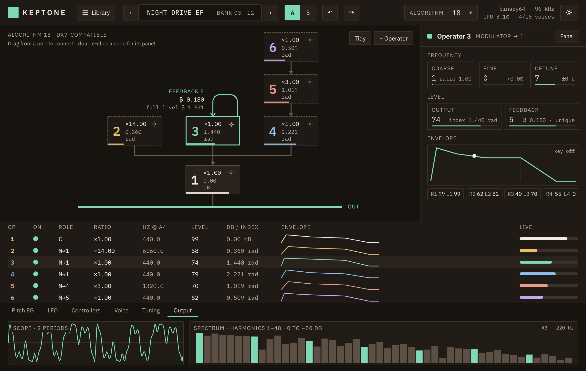

<!--
SPDX-FileCopyrightText: 2026 Yuma Kakei <yumasansansan@gmail.com>
SPDX-License-Identifier: GPL-3.0-or-later

このファイルは README.md の日本語版で，Keptone の一部です．SPDX の行は，著作権者とライセンスを REUSE 仕様の機械可読な形式で示しています．ライセンスは GNU General Public License バージョン 3 またはそれ以降のバージョン（LICENSES/GPL-3.0-or-later.txt）です．
-->

# Keptone
開発中の 6 オペレーター FM シンセサイザープラグインです．ハードウェアの制約がない今，DX シリーズをプラグインとして作ったらどのようなものになるかを考えるプロジェクトです．特定のハードウェアを模倣することはなく，対象を DX7 に限ることもありませんが，DX シリーズの「きれいな」音から外れることはありません．Yamaha DX7 のパッチを読み込んで演奏や編集ができ，その音を「理想 DX7」として計算します．つまり，パッチのパラメーターが表す連続時間の信号を，ホストのサンプルレートで binary64 を用いて求め，エイリアシングを抑え，1983 年のハードウェアに由来する量子化とノイズを取り除きます．CLAP にネイティブに対応し，VST3，AUv2，スタンドアロン版は [clap-wrapper](https://github.com/free-audio/clap-wrapper) を使って提供します．Linux，Windows，macOS を対象としています．

[English](README.md) | 日本語



*設計中のエディターです（[docs/UI.md](docs/UI.md)，[docs/mockups/](docs/mockups/README.md)）．まだ実装していません．*

## 目指すもの

- **パッチの意味に忠実．** DX7 のパッチが持つエンベロープ，キーボードスケーリング，モジュレーション，フィードバック，アルゴリズムは，そのまま保たれます．DX7 の法則とテーブルは残し，ハードウェアに由来するアーティファクトは取り除きます．具体的には，12 ビット DAC，log-sine ROM と指数 ROM による量子化，クロックごとに加わるエンベロープの増分，有限長の位相アキュムレーター，49,096 Hz でのサンプリングとそれによるエイリアシングです（[docs/MATH.md](docs/MATH.md) §15）．
- **クリーンな出力．** エイリアシング，ジッパーノイズ，量子化ノイズを測定し，プロジェクトで定めた閾値より低く抑えます．位相変調は正弦波の ADAA（antiderivative antialiasing）によって閉形式でアンチエイリアシングし，内部でのオーバーサンプリングも設定で選べるようにしています（MATH §10，§11）．
- **フィードバックを方程式として解く．** ループゲインが 1 未満であれば，DX7 の遅延を含むフィードバックループは，サンプルレートを上げるにつれてケプラー方程式 Θ − β sin Θ = Φ の解に近づきます．Tomisawa の特許（[US 4,249,447](https://patents.google.com/patent/US4249447A/en)）は，オペレーターをまさにこの形で記述しています．Keptone はこの方程式をサンプルごとに解き，ほかのオペレーターから変調を受けないオペレーターについては，その厳密なフーリエ級数であるカプタイン級数をナイキスト周波数まで足し合わせます．ゲインが 1 以上の場合は遅延のない極限が存在しないため，設定で選んだモデルを使います（MATH §9）．Keptone という名前は，Kepler と tone を合わせたものです．
- **自由．** 挙動を変える選択はすべて設定として用意し，既定値を文書に明記しています（MATH §17）．ボイス数，オペレーター数，オーバーサンプリングの倍率，許容誤差，テーブルサイズには，メモリ以外の上限がありません．
- **DX7 の同系機．** DX1，TX7，DX7II，DX7s，TX802 が DX7 に加えたもの，つまり 2 つのボイスのレイヤーとスプリット，ボイスごとのファンクションデータ，ボイスのサプリメント，パフォーマンス，パン，マイクロチューニング，フラクショナルスケーリング，より多くのトーンジェネレーターも，Keptone 自身の機能として備えます．Keptone が実機を再現することは決してありません．ユーザーが設定した数のパートを鳴らし，各機種のデータはそれらのパートに読み込みます（[docs/DESIGN.md](docs/DESIGN.md) §6.4）．
- **安全でリアルタイム．** パッチファイル，SysEx，ホストが保存した状態，チューニングファイルは，どのようなバイト列に対しても値またはエラーを返すパーサーで，型付きの値に変換します．そのため，悪意のある入力であっても，メモリ安全性の破壊，オーディオスレッドでのパニック，非有限の出力を引き起こすことはありません．オーディオスレッドは，メモリの確保と解放，ロック，システムコールを一切行いません．
- **正確で再現可能．** 各カーネルは，高精度の参照値に対して明示した誤差の上限（accuracy contract）を満たします．同じビルド，同じカーネルの選択，同じ設定，同じ入力からは，ホストが時間をどのようなブロックに区切っても，ビット単位で同一の出力が得られます（MATH §0）．

## 現状

計画（[docs/DESIGN.md](docs/DESIGN.md) §16）のマイルストーン M3（エンジン）に取り組んでいます．まだ音は出ません．

- **M0**：ワークスペース．プロジェクトの lint 設定を適用した 13 のクレート，ツールチェーン，Windows・Ubuntu・macOS での CI，そして仕様．
- **M1**：`keptone-math`．turn 単位で表した位相の正弦と余弦，2 を底とする指数関数，sinc とその導関数，1 次と 2 次のアンチデリバティブアンチエイリアシング（ADAA），ケプラー方程式のソルバーとカプタイン級数のテーブル．CORE-MATH の正しく丸められた関数や mpmath と比較してテストしています．
- **M2**：`keptone-model`．DX7 とその同系機のデータ（数値はすべて，任意の有限な binary64 の値をとれます）．それらのシステムエクスクルーシブメッセージ（`.syx` ファイルから読み込み，書き出すとバイト単位で元どおりになります）．ネイティブ形式の状態（[docs/STATE-FORMAT.md](docs/STATE-FORMAT.md)）と，そのための JSON のサブセット，SHA-256，設定，パラメーターの安定した ID．Scala 形式のチューニング．パーサーはすべて，CI で libFuzzer を使ってファジングしています．
- **M3（ここまで）**：`keptone-math` には，対数 log₂ x と log₂(1 + x)，および 2^z − 1 を加えました．CORE-MATH との差は 1 ulp 以内で，エンジンはシステムの libm の代わりにこれらを使います．`keptone-model` にはオペレーターのグラフを加えました．DX7 の 32 のアルゴリズムはこのグラフの値として表し，グラフとは別に作られた 2 つの符号化と照合しています．`keptone-engine` には，ピッチと位相，レベル，オペレーターとピッチのエンベロープ，LFO，コントローラーと振幅変調，ポルタメント，フィードバックの各法則，コンパイル済みのパッチ，ボイスがオペレーターを評価する順序を実装しました．1 サンプルやその一部は区間に分け，ピッチとレートスケーリングのキーが動くときは，位相とエンベロープをこの区間ごとに積分します．オペレーターはサンプルごとに評価し，フィードバックはどのモデルでも，複数のオペレーターにまたがるループも含めて扱います．さらに，これらをつないでノートを演奏するボイスと，パートがノートをボイスに振り分けるエンジンを実装しました．エンジンは，ポリとモノ，ポルタメントのグライド，演奏中のパッチ変更に対応しています．また，`keptone-tools render` で，パッチのノートを WAV ファイルにレンダリングできます．各法則は，厳密な値，または厳密な算術で実行したシナリオと比較してテストしています．

次は，適合性テスト用パッチのレンダリングを含む，MATH §16 のテスト群に取り組みます．

| クレート | 実装する内容 | マイルストーン |
| --- | --- | --- |
| `keptone-math` | binary64 の参照関数（turn 単位で表した位相の正弦，sinc，指数関数と対数関数，ADAA，ケプラー方程式のソルバーとカプタイン級数のテーブル） | M1，M3 |
| `keptone-model` | 型付きのパッチモデル，オペレーターのグラフと DX7 のアルゴリズム，パーサー（DX7 の SysEx・`.syx` ファイル，ネイティブ形式の状態，Scala 形式のチューニング） | M2，M3 |
| `keptone-engine` | ボイス，エンベロープ，LFO，オペレーターのグラフ，フィードバック，オーバーサンプリング，ミックス | M3，M4 |
| `keptone-tools` | コマンドラインツール（オフラインレンダリングと参照レンダリング，エイリアシングの指標，`.syx` の操作，ベンチマーク） | M3 以降 |
| `keptone-rt` | オーディオスレッドとほかのスレッドをつなぐ wait-free なキュー | M5 |
| `keptone-host` | プラグイン形式に依存しないプロセッサー（パラメーター，イベント，スレッド，状態） | M5 |
| `keptone-clap` | CLAP プラグイン（ABI は手で宣言） | M5 |
| `keptone-cpu` | プロセッサーの機能と，使用するカーネルのレベル | M7 |
| `keptone-kernels` | 内側のループをベクトル化したアセンブリ（アーキテクチャと命令セットのレベルごとに用意） | M7 |
| `keptone-sys` | OS の関数（手で宣言） | 必要に応じて |
| `keptone-platform` | Win32，AppKit，X11，Wayland 上のエディターのウィンドウ | M8a |
| `keptone-render` | エディターのシーンとそのレンダラー（基準となる CPU 版，Direct3D 11，Metal，Vulkan） | M8a |
| `keptone-ui` | エディター | M8b |

clap-wrapper による VST3，AUv2，スタンドアロン版のビルドは M6 で加わります．

## 仕様

- [docs/MATH.md](docs/MATH.md)：モデルと数値計算法は，この文書だけに記述しています．コードはこれに従い，挙動を変えるときは，まずこの文書を変更します．
- [docs/DESIGN.md](docs/DESIGN.md)：アーキテクチャ，クレート，スレッド，データ形式，方針，マイルストーン，未決事項．
- [docs/UI.md](docs/UI.md)：エディター．[docs/mockups/](docs/mockups/README.md) にモックアップが，[assets/themes/](assets/themes/) に 3 つの組み込みテーマがあります．
- [docs/REFERENCES.md](docs/REFERENCES.md)：出典．文書とコードは，[LEVIEN-EG] のようなキーで引用します．
- [docs/VERIFICATION.md](docs/VERIFICATION.md)：暫定的に採用した値の一覧です．それぞれ，その値を使うマイルストーンを完了する前に，独立した出典と照合します．
- [docs/DEPENDENCIES.md](docs/DEPENDENCIES.md)：Keptone が依存するもの，その理由，ライセンス，バージョン．

## ビルドとテスト

最新の stable の Rust と，Clang および LLD を使います．どのシステムでも，リンクは Clang をドライバーとして LLD で行います（`.cargo/config.toml`）．CI では LLVM のバージョンを 23.1.5 に固定しています（`ci/setup.sh`）．x86-64 向けのビルドは x86-64-v3（AVX2，FMA，BMI2）を対象とし，AVX-512 向けにコンパイルするコードは，すべて 512 ビット幅のベクトルを使います．macOS 向けのビルドは，Apple シリコンと macOS 26 以降を対象としています．

```bash
cargo build --release --locked
```

```bash
bash ci/core-math.sh
```

```bash
bash ci/rust.sh
```

`ci/core-math.sh` は，`keptone-math` のテストが Clang でコンパイルして比較に使う CORE-MATH のファイルを，サブモジュール `thirdparty/core-math` が記録しているコミットから取得します．CORE-MATH 全体が必要な場合は，`git submodule update --init` を使います．`ci/rust.sh` は，コードの整形，clippy（警告はすべてエラー扱い），ドキュメントを検査し，dev と release の両方のプロファイルでテストを実行します．`bash ci/targets.sh test` は，512 ビット幅のベクトルを使う x86-64-v4 向けにワークスペースをビルドし，プロセッサーが AVX-512 を備えていればテストも行います．`bash ci/emulated.sh <sde64>` は，[Intel SDE](https://www.intel.com/content/www/us/en/developer/articles/tool/software-development-emulator.html) で Haswell，Alder Lake，Arrow Lake，Skylake-SP，Ice Lake-SP，Sapphire Rapids をエミュレートしてテストを実行します．`bash ci/python.sh` は `scripts/` を ruff で検査し，`reuse lint` はすべてのファイルについて著作権とライセンスの表記を確認します．`bash ci/fuzz.sh setup` は，ファジング用にバージョンを固定した nightly のツールチェーンと cargo-fuzz をインストールします．`bash ci/fuzz.sh <秒数> <コーパス> <クラッシュ>` は，`keptone-model` の各パーサーを x86-64 の Linux 上で，libFuzzer を使って指定した秒数だけファジングします．CI では，push のたびに 1 分ずつ，毎日 30 分ずつ，このファジングを行っています．

## ライセンス

Keptone は GNU General Public License バージョン 3 またはそれ以降のバージョン（`LICENSES/GPL-3.0-or-later.txt`）のもとで配布するフリーソフトウェアです．各ファイルには [REUSE](https://reuse.software/) 仕様の形式で著作権者とライセンスを記しており，`reuse lint` でその表記を検査しています．

リポジトリには Yamaha のファームウェア，ROM のテーブル，ファクトリーボイスを含めていません（docs/DESIGN.md §14）．Yamaha および DX7 はヤマハ株式会社の商標または登録商標であり，ここでは Keptone が演奏するパッチの種類を示すためにのみ用いています．Keptone はヤマハ株式会社とは関係がありません．VST は Steinberg Media Technologies GmbH の登録商標です．
