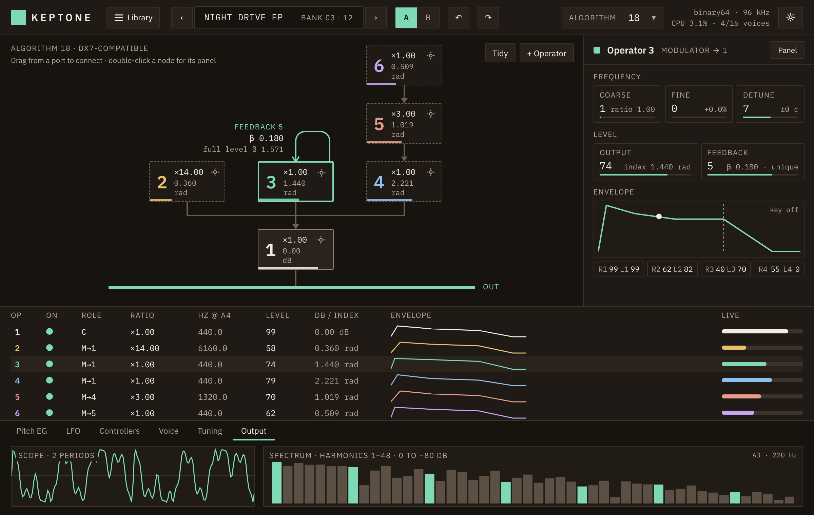

<!--
SPDX-FileCopyrightText: 2026 Yuma Kakei <yumasansansan@gmail.com>
SPDX-License-Identifier: GPL-3.0-or-later

This file is part of Keptone. The SPDX lines name its copyright holder and its
license, in the machine-readable form of the REUSE specification: the GNU
General Public License, version 3 or any later version
(LICENSES/GPL-3.0-or-later.txt).
-->

# Keptone
A six-operator FM synthesizer plugin in the making. It asks what the DX series would be, made today as a plugin with none of its hardware's constraints: it imitates no hardware and is not limited to the DX7, yet it never strays from the clean sound of the DX series. It plays and edits Yamaha DX7 patches and computes them as an *ideal DX7*: the continuous-time signal that a patch's parameters describe, computed in binary64 at the host's sample rate, antialiased, and without the quantisation and noise of the 1983 hardware. CLAP natively; VST3, AUv2 and a standalone program through [clap-wrapper](https://github.com/free-audio/clap-wrapper). Linux, Windows and macOS.

English | [日本語](README.ja.md)



*The editor as designed ([docs/UI.md](docs/UI.md), [docs/mockups/](docs/mockups/README.md)). None of it is built yet.*

## What it is to be

- **Faithful in meaning.** A DX7 patch keeps its envelopes, keyboard scaling, modulation, feedback and algorithm: the DX7's laws and tables stay, and its hardware artefacts go -- the 12-bit DAC, the quantisation of the log-sine and exponential ROMs, the clocked increments of the envelopes, the finite phase accumulator, and the sampling at 49,096 Hz with its aliasing ([docs/MATH.md](docs/MATH.md) §15).
- **Clean.** Aliasing, zipper noise and quantisation noise are measured and pushed below thresholds the project sets. Phase modulation is antialiased in closed form, by antiderivative antialiasing of the sine, with internal oversampling as a setting (MATH §10, §11).
- **The feedback operator solved.** For loop gains below 1, the DX7's delayed feedback loop tends, as the sample rate grows, to the solution of Kepler's equation, Θ − β sin Θ = Φ, which is how Tomisawa's patent ([US 4,249,447](https://patents.google.com/patent/US4249447A/en)) states the operator. Keptone solves it at every sample, and where nothing else modulates the operator, sums its exact Fourier series, a Kapteyn series, up to the Nyquist frequency. Gains of 1 and above, which have no delay-free limit, take a model chosen by a setting (MATH §9). Hence the name: Kepler and tone.
- **Free.** Every choice that changes behaviour is a setting with a documented default (MATH §17). Polyphony, the number of operators, oversampling, tolerances and table sizes are bounded only by memory.
- **The DX7's family.** What the DX1, the TX7, the DX7II, the DX7s and the TX802 added to the DX7 -- two voices layered or split, function data for each voice, supplements of voices, performances, pan, micro tunings, fractional scalings and more tone generators -- is to be Keptone's as well, as its own features: Keptone never reproduces an instrument. It plays parts, as many as the user sets, and reads each instrument's data into them ([docs/DESIGN.md](docs/DESIGN.md) §6.4).
- **Safe and real-time.** Patch files, SysEx, the host's state and tuning files are parsed into typed values by parsers that give a value or an error for any bytes, so that hostile input can never cause memory unsafety, a panic on the audio thread or a non-finite output. The audio thread never allocates, frees, locks or makes a system call.
- **Accurate and reproducible.** Every kernel meets a stated accuracy contract against a high-precision reference, and one build, one choice of kernels, one set of settings and one input give the same output bit for bit, however the host splits time into blocks (MATH §0).

## Where it stands

Milestone M3 of the plan ([docs/DESIGN.md](docs/DESIGN.md) §16), the engine, is under way. Nothing plays yet.

- **M0**, the workspace: thirteen crates under the project's lints, the toolchains, the CI on Windows, Ubuntu and macOS, and the specification.
- **M1**, `keptone-math`: the sine and cosine of a phase in turns, the exponential of base 2, sinc and its derivative, antiderivative antialiasing of the first and second orders, the solver of Kepler's equation and the tables of its Kapteyn series, tested against CORE-MATH's correctly rounded functions and against mpmath.
- **M2**, `keptone-model`: the data of the DX7 and of its family, every number of it any finite binary64; their system-exclusive messages, read from `.syx` files and written back byte for byte; the native state ([docs/STATE-FORMAT.md](docs/STATE-FORMAT.md)) with its subset of JSON, SHA-256, the settings and the parameters' stable IDs; and Scala's tunings. Every parser is fuzzed with libFuzzer in the CI.
- **M3, so far**: in `keptone-math`, the logarithms log₂ x and log₂(1 + x) and 2^z − 1, within 1 ulp of CORE-MATH's, which the engine takes in place of the system's libm; in `keptone-model`, the operator graph, of which the DX7's 32 algorithms are values, checked against two encodings made apart from it; and in `keptone-engine`, the order in which a voice evaluates its operators, the laws of pitch and phase, of level, of the operator and pitch envelopes, of the LFO, of the controllers and the amplitude modulation, of the portamento and of feedback, the compiled patch, the pieces of a sample or of a part of one, over which the phases and the envelopes are integrated as the pitch and the rates' key move, and a voice's operators at a sample, with their feedback by every model, through several operators too. Each law is tested against its exact value, or against scenarios run in exact arithmetic.

The voice that puts these laws together comes next, and then the voices of a part, the output and the command line that renders a patch.

| Crate | What it is to hold | Milestone |
| --- | --- | --- |
| `keptone-math` | The reference functions in binary64: the sine of a phase in turns, sinc, the exponential and the logarithm, antiderivative antialiasing, the solver of Kepler's equation and the tables of its Kapteyn series | M1, M3 |
| `keptone-model` | The typed patch model, the operator graph and the DX7's algorithms, and the parsers of DX7 SysEx and `.syx` files, the native state and Scala tunings | M2, M3 |
| `keptone-engine` | Voices, envelopes, the LFO, the operator graph, feedback, oversampling and the mix | M3, M4 |
| `keptone-tools` | The command line: offline and reference rendering, the alias metric, `.syx` tools, benchmarks | M3 on |
| `keptone-rt` | The wait-free queues between the audio thread and the others | M5 |
| `keptone-host` | The processor, independent of the plugin format: parameters, events, threads, state | M5 |
| `keptone-clap` | The CLAP plugin, its ABI declared by hand | M5 |
| `keptone-cpu` | The processor's features, and the level of the kernels in effect | M7 |
| `keptone-kernels` | Vector forms of the inner loops, in assembly, per architecture and level | M7 |
| `keptone-sys` | The operating systems' functions, declared by hand | as needed |
| `keptone-platform` | The editor's window on Win32, AppKit, X11 and Wayland | M8a |
| `keptone-render` | The editor's scene, and its renderers: CPU (the reference), Direct3D 11, Metal, Vulkan | M8a |
| `keptone-ui` | The editor | M8b |

The VST3, AUv2 and standalone builds through clap-wrapper come in M6.

## The specification

- [docs/MATH.md](docs/MATH.md): the model and its numerical methods, the only statement of them. The code follows it, and a change of behaviour is made there first.
- [docs/DESIGN.md](docs/DESIGN.md): the architecture, crates, threads, formats and policies, the milestones and the open decisions.
- [docs/UI.md](docs/UI.md): the editor. [docs/mockups/](docs/mockups/README.md) shows it, and [assets/themes/](assets/themes/) holds its three built-in themes.
- [docs/REFERENCES.md](docs/REFERENCES.md): the sources, which the documents and the code cite by key, such as [LEVIEN-EG].
- [docs/VERIFICATION.md](docs/VERIFICATION.md): the values taken provisionally, each to be checked against an independent source before the milestone that uses it closes.
- [docs/DEPENDENCIES.md](docs/DEPENDENCIES.md): what Keptone depends on, why, under which license, and at which version.

## Building and testing

The latest stable Rust, and Clang and LLD: Clang drives the link and LLD links on every system (`.cargo/config.toml`). The CI pins LLVM 23.1.5 (`ci/setup.sh`). The builds for x86-64 are for x86-64-v3 (AVX2, FMA, BMI2), and wherever they compile code for AVX-512, it takes vectors of 512 bits. The builds for macOS are for Apple silicon and macOS 26 and later.

```bash
cargo build --release --locked
```

```bash
bash ci/core-math.sh
```

```bash
bash ci/rust.sh
```

`ci/core-math.sh` fetches the files of CORE-MATH that the tests of `keptone-math` compile with Clang and compare with, at the commit that the submodule `thirdparty/core-math` records; `git submodule update --init` fetches all of CORE-MATH instead. `ci/rust.sh` checks the layout, clippy with every warning an error, and the documentation, and runs the tests in the dev and the release profile. `bash ci/targets.sh test` builds the workspace for x86-64-v4 with vectors of 512 bits, and tests it where the processor has AVX-512. `bash ci/emulated.sh <sde64>` runs the tests under [Intel SDE](https://www.intel.com/content/www/us/en/developer/articles/tool/software-development-emulator.html) as Haswell, Alder Lake, Arrow Lake, Skylake-SP, Ice Lake-SP and Sapphire Rapids. `bash ci/python.sh` checks `scripts/` with ruff, and `reuse lint` the licensing of every file. `bash ci/fuzz.sh setup` installs the nightly toolchain and the cargo-fuzz that the fuzzing pins, and `bash ci/fuzz.sh <seconds> <corpora> <crashes>` fuzzes each parser of `keptone-model` with libFuzzer for that many seconds, on x86-64 Linux, as the CI does for a minute on every push and for half an hour every day.

## License

Keptone is free software under the GNU General Public License, version 3 or any later version (`LICENSES/GPL-3.0-or-later.txt`). Each file names its copyright holder and license in the form of the [REUSE](https://reuse.software/) specification, which `reuse lint` checks.

The repository holds no Yamaha firmware, ROM tables or factory voices (docs/DESIGN.md §14). Yamaha and DX7 are trademarks or registered trademarks of Yamaha Corporation, named here only to say which patches Keptone plays; Keptone is not affiliated with Yamaha. VST is a registered trademark of Steinberg Media Technologies GmbH.
